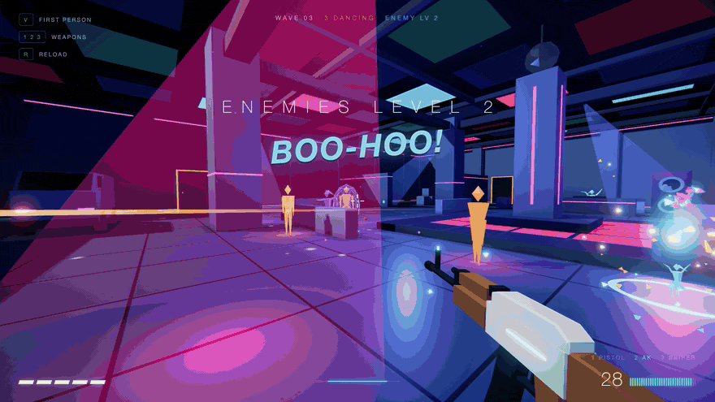
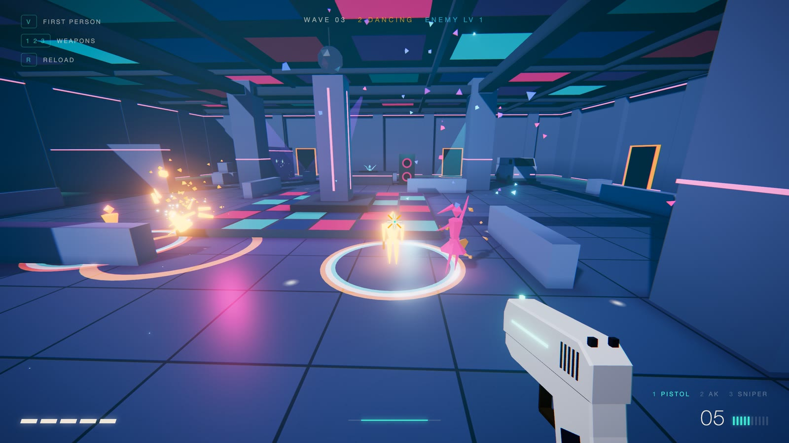
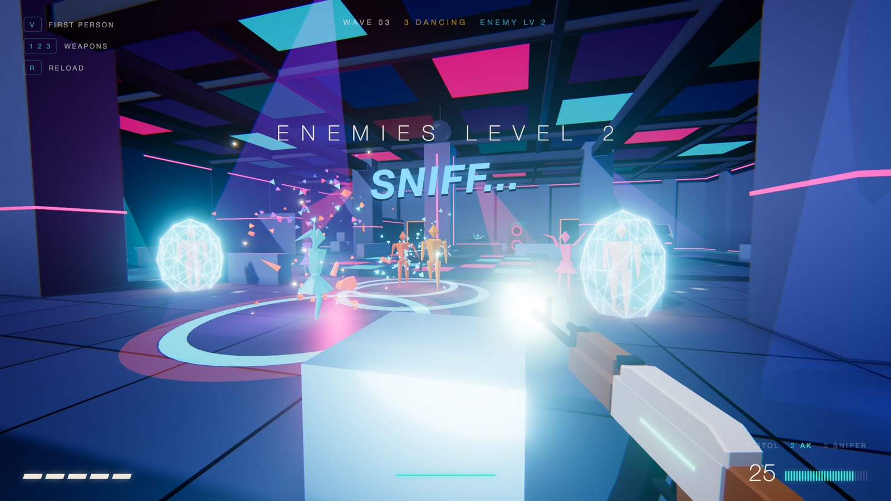
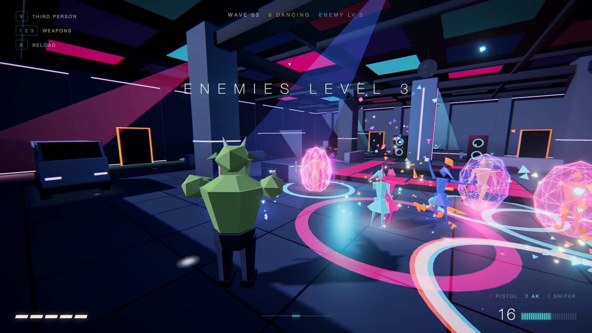
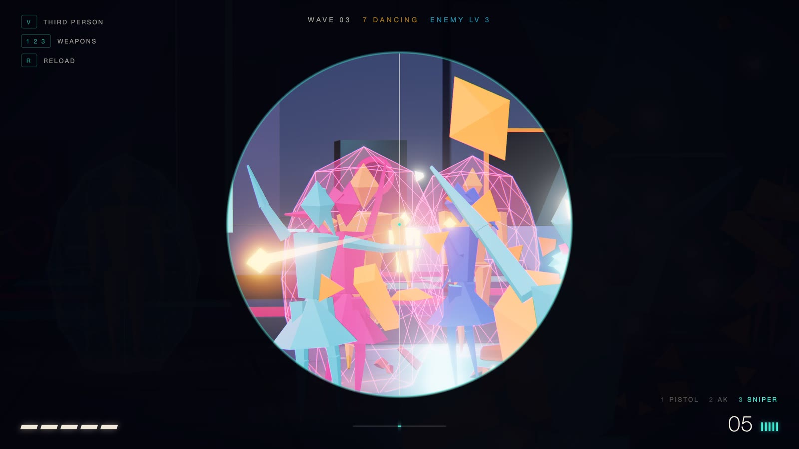
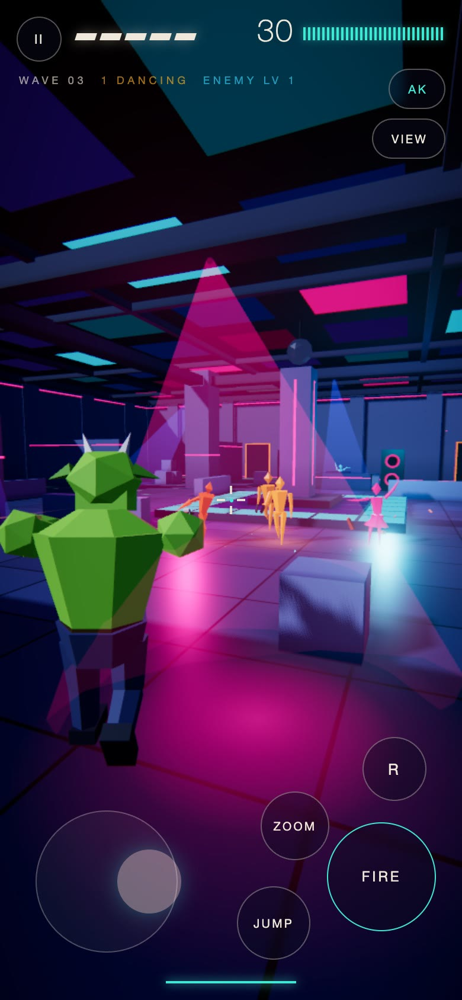

# STILLPOINT

**Play it: https://stillpoint-gray.vercel.app**

A shooter where the world only moves when you do. Stand still and enemies,
bullets and debris freeze; walk and time flows; sprint and it runs at full
speed. Every kill brings a dancer onto the floor, so the club fills up as you
win — and the enemies that are left get shields.

<a href="https://stillpoint-gray.vercel.app"></a>

Full 31-second clip with sound — a first-person opening, then third-person,
all three guns and a quick-scope: [docs/demo.mp4](docs/demo.mp4)

## Pictures

| First-person | Enemies with shields |
|---|---|
|  |  |

| Third-person | Sniper scope |
|---|---|
|  |  |

On a phone, on-screen controls appear:



## What is in it

- **Time control** — the world runs at 2% speed while you stand still and at full speed when you run. Shooting and reloading push time forward briefly.
- **Two views** — first-person by default, third-person on `V` (an original muscle-bound ogre). The sniper scope always looks through his eyes.
- **Three guns** — pistol, AK (hold to fire) and a scoped sniper that shoots through enemies.
- **Enemies that learn** — every kill gives each survivor a shield point; every 3 kills raises the enemy level.
- **A party** — light-up dance floor, moving beams, mirror ball, LED ceiling, a DJ, and generated club music that goes muffled when time freezes.
- **After a kill** — a dancer appears with confetti, and the ogre sits down and cries.
- **Installable** — on Chrome, Edge and Android the title screen shows an *Install game* button; on iPhone use Share → Add to Home Screen. Once installed it starts without a connection.
- **Runs on weak phones** — three graphics tiers, chosen for the device, and the game steps down by itself if the frame rate stays low.
- **No asset files** — geometry, textures, sound effects and music are all generated in code with Three.js and the Web Audio API.

## Run

```bash
npm install
npm run dev
```

Then open http://localhost:5173 in Chrome or Safari and click to begin.
(The game captures the mouse; press Esc to release it.)

## Controls

| Key | Action |
|---|---|
| W A S D | Move |
| Mouse | Aim |
| Left click | Fire (hold for the AK) |
| Right click | Zoom / sniper scope |
| 1 2 3 or wheel | Pistol, AK, sniper |
| R | Reload |
| Space | Jump |
| Shift | Slow walk (slow time) |
| V | Switch third / first person |
| M | Music on / off |
| Esc | Pause |

On a phone, or in a window narrower than 820 px, on-screen controls appear:
a floating joystick for the left thumb (push gently to walk slowly), drag to
look with the right thumb, and buttons for fire, jump, reload, zoom, weapon
and view. To try it on your phone, run `npm run dev -- --host` and open the
Network address it prints (phone and computer on the same Wi-Fi).

Optional: put a real crying recording at `public/sounds/cry.mp3` and the hero
uses it after a kill instead of the built-in synthesised voice.

## How it is built

`Game.js` owns every system and runs one frame in this order:
input → player (real time) → `TimeSystem` picks the world speed → enemies,
bullets and effects advance by that scaled time → render.
The party (music, lights, dancers) always runs on real time, to the beat.

| File | Job |
|---|---|
| `src/config.js` | Every tunable number: speeds, time curve, weapons, enemies, colours, graphics tiers |
| `src/core/Game.js` | Game states and the frame loop |
| `src/core/TimeSystem.js` | Turns player activity into world speed |
| `src/core/Input.js` | Keyboard, mouse, pointer lock |
| `src/core/AudioSystem.js`, `Music.js` | Synthesised sound effects and the soundtrack |
| `src/player/PlayerController.js` | Movement, jumping, collision, health |
| `src/player/CameraController.js` | Third / first-person camera, recoil, zoom, shake |
| `src/player/PlayerAvatar.js` | The ogre hero model and its animation |
| `src/weapons/Weapon.js`, `weaponModels.js` | Gun behaviour and the three gun models |
| `src/weapons/ProjectileSystem.js` | Travelling bullets and what they hit |
| `src/enemies/Enemy.js`, `EnemyManager.js` | Enemy models, AI, waves |
| `src/world/Arena.js`, `Collision.js`, `NavGrid.js` | Level geometry, physics queries, pathfinding |
| `src/world/Party.js`, `src/party/Dancers.js` | Dance floor, lights, mirror ball, dancers |
| `src/fx/Effects.js` | Shards, flashes, confetti, debris |
| `src/render/Renderer.js` | Lights, shadows, bloom, colour grade |
| `src/ui/HUD.js` | Crosshair, health, ammo, screens |
| `src/ui/TouchControls.js` | On-screen joystick and buttons for phones |
| `src/ui/install.js`, `public/sw.js`, `public/manifest.webmanifest` | Install-as-app button, offline support, app name and icons |

## Performance

The arena is built from about 250 boxes, but nothing in it moves, so
`Arena.mergeStatic()` fuses everything that shares a material into one mesh:
the whole building draws in about 14 commands instead of 250.

| Tier | Used for | Resolution cap | Shadows | Glow (bloom) | Edge smoothing |
|---|---|---|---|---|---|
| high | desktop | 1.5x | 4096 map | on | 4x |
| medium | phones | 1.25x | 2048 map | on | 2x |
| low | phones with ≤4 GB memory or ≤4 cores | 1x | off (soft contact shadows stay) | off | off |

While you play, `Game.watchPerformance()` checks the real frame rate every
2.5 seconds. Under 44 fps it drops one tier; on the lowest tier it lowers the
resolution instead. Add `?quality=low` (or `medium`, `high`) to the address to
force a tier.

## Re-filming the demo

`tools/record.mjs` films the clip and stills above: a scripted bot plays the
real game in headless Chrome, one exact 1/60 s step at a time, and the game's
own sound is captured on the same clock.

```bash
npm i --no-save puppeteer-core
npm run dev
```

```bash
SCALE=3 FPS=60 node tools/record.mjs demo-4k.mp4 - desktop 31
```

```bash
SCALE=2.6666667 FPS=60 OUT_WIDTH=1080 node tools/record.mjs demo-vertical.mp4 - mobile 15
```

The first command films 3840x2160 at 60 fps (YouTube size), the second a
1080x1920 vertical cut with the phone controls on screen.
`tools/brand.mjs` renders the favicon PNGs, app icons and the share picture.

Made by [Hamzeh](https://hamzeh.framer.ai/?utm_source=mini-game&utm_medium=referral).
